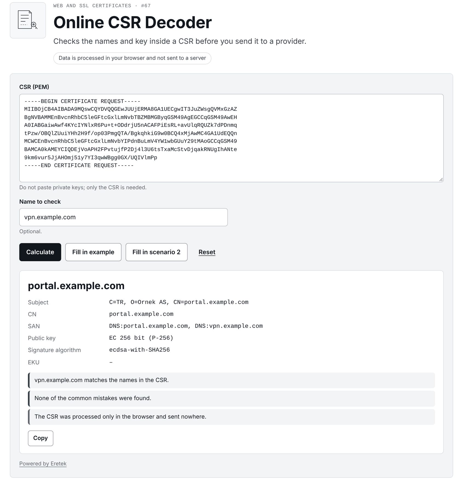

# CSR Decoder

Decode a PEM CSR in your browser: subject, SAN names, key type and size, signature algorithm; catch mistakes before sending it to a certificate provider.

## Try it live

- [Türkçe](https://web.eretek.com/araclar/csr-okuyucu)
- [English](https://web.eretek.com/en/tools/csr-decoder)
- [Deutsch](https://web.eretek.com/de/werkzeuge/csr-decoder)



## What it does

Checks the names and key inside a CSR before you send it to a provider.

A CSR with a wrong or missing SAN means reissuing a paid certificate and days of delay. The tool decodes the subject, requested SAN names and key, and points out common mistakes such as CN missing from SAN, weak keys, an invalid country code or internal names.

## Where it helps

If SAN is missing or the key is weak, regenerate the CSR (OpenSSL: `-addext "subjectAltName=DNS:…"`). Verify the issued certificate with the PEM Certificate Decoder.

## How to use it

1. Paste the CSR starting with `-----BEGIN CERTIFICATE REQUEST-----`.
2. Optionally enter a name the certificate must cover; press Run.

### Fields

| Field | Description |
|---|---|
| CSR (PEM) | Do not paste private keys; only the CSR is needed. |
| Name to check | Optional. |

## Example input

Press **Fill in example** in the tool to load this input.

| Input | Value |
|---|---|
| Name to check | `vpn.example.com` |

**CSR (PEM)**

```text
-----BEGIN CERTIFICATE REQUEST-----
MIIBOjCB4AIBADA9MQswCQYDVQQGEwJUUjERMA8GA1UECgwIT3JuZWsgQVMxGzAZ
BgNVBAMMEnBvcnRhbC5leGFtcGxlLmNvbTBZMBMGByqGSM49AgEGCCqGSM49AwEH
A0IABGaiwAwf4KYcIYNlxR6Pu+t+ODdrjU5nACAFPiEsRL+avUlqRQUZk7dPDnmq
tPzw/OBQlZUuiYHh2H9f/op03PmgQTA/BgkqhkiG9w0BCQ4xMjAwMC4GA1UdEQQn
MCWCEnBvcnRhbC5leGFtcGxlLmNvbYIPdnBuLmV4YW1wbGUuY29tMAoGCCqGSM49
BAMCA0kAMEYCIQDEjVoAPH2FPvtujfP2Dj4l3U6tsTxaMcStvDjqakRNUgIhANte
9km6vur5JjAHOmj51y7YI3qwWBgg0GX/UQIVlmPp
-----END CERTIFICATE REQUEST-----

```

**Expected result:** CN portal.example.com, SAN portal.example.com and vpn.example.com, EC P-256, ecdsa-with-SHA256; vpn.example.com matches a SAN.

## Method and assumptions

The PEM block is decoded from Base64 to DER; subject, SubjectPublicKeyInfo and SAN/EKU from the extensionRequest attribute of the PKCS#10 CertificationRequestInfo are read.

## Limits and common mistakes

- The CSR signature (match with the private key) is not verified.

## Run it locally

The tool is plain HTML, CSS and JavaScript with no build step and no dependencies.

```bash
git clone https://github.com/eretek/csr-decoder.git
cd csr-decoder
node scripts/serve.js        # or: python3 -m http.server 8080
```

Open <http://127.0.0.1:8080/>. Add `?lang=tr` or `?lang=de` for Turkish or German; without it the page follows the browser language and falls back to English. You can also open `index.html` directly from disk.

Run the tests (Node.js 18 or later):

```bash
node test/run.js    # or: npm test
```

The tests run the tool's own fixtures and the worked examples in all three languages without a browser.

## How it works

All processing happens in your browser. The tool makes no network requests, uses no cookies or browser storage, and does not upload files you select.

No server-side component is needed. The version on the Eretek website renders the same page through a private WordPress plugin; that plugin only produces the page markup and is not part of this repository.

| Path | Purpose |
|---|---|
| `index.html` | Page shell |
| `src/app.js` | Builds the page in Turkish, English or German from `src/data.js` |
| `src/data.js` | Field definitions, examples and all texts in three languages |
| `src/core.js` | Shared runtime: validation, number formats, result rendering, CSV/ICS export |
| `src/tool.js` | The calculation or analysis for this tool |
| `docs/screenshot.png` | Screenshot used in this README |
| `src/lib/asn1.js` | DER/ASN.1, PEM, X.509 and CSR reader |
| `src/tools.css`, `src/page.css` | Styles |
| `test/run.js`, `test/cases.json` | Headless tests |

## License and attribution

This tool is released under the [Eretek Website Attribution License](LICENSE). You may use, modify and redistribute it, including commercially. If you make it available on a website or web application, show a visible, clickable credit linking to https://eretek.com/ on every page where the tool is available, for example:

```html
<a href="https://eretek.com/">Powered by Eretek</a>
```

You may add `rel="nofollow"` to the link. Keep the copyright notice and license text in copies and redistributions.
